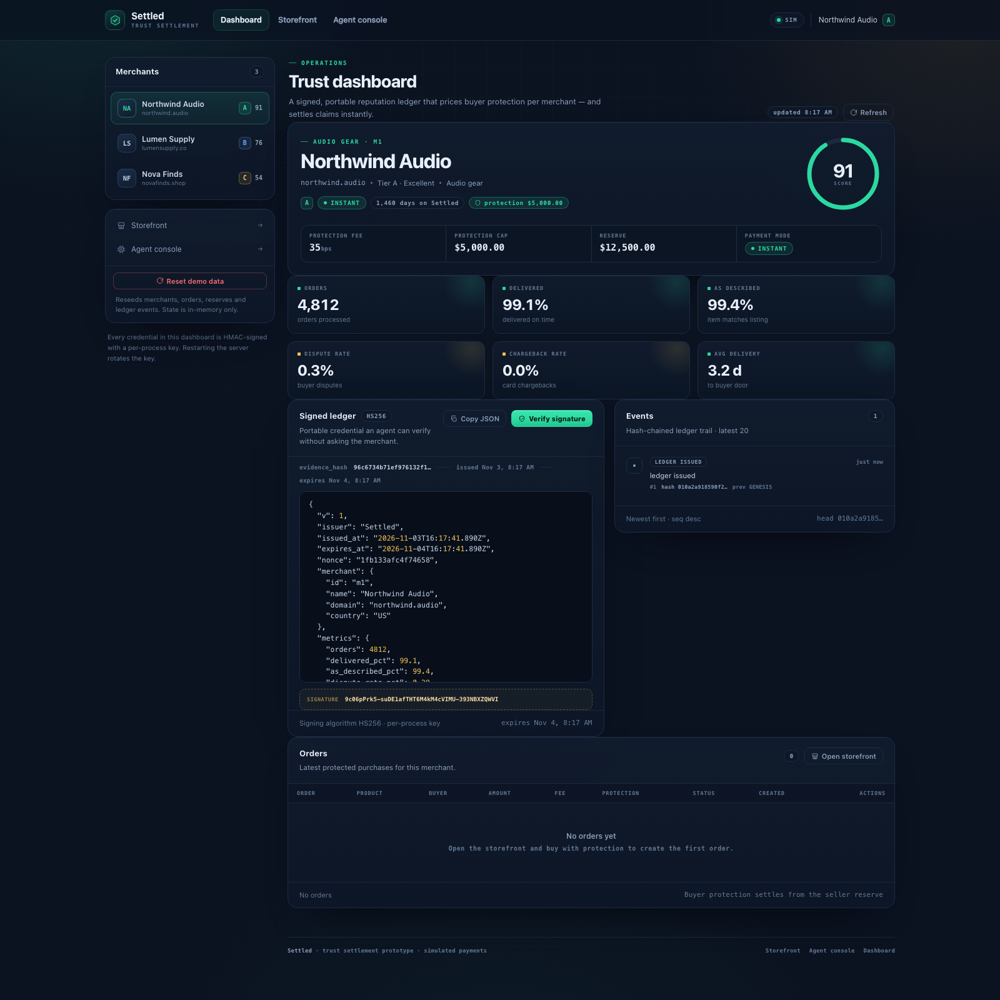
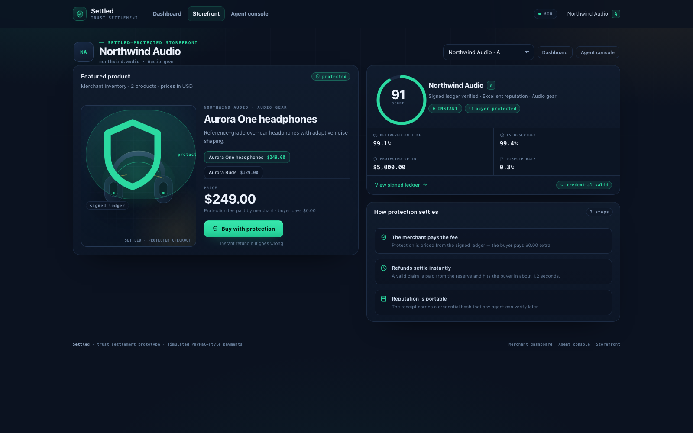
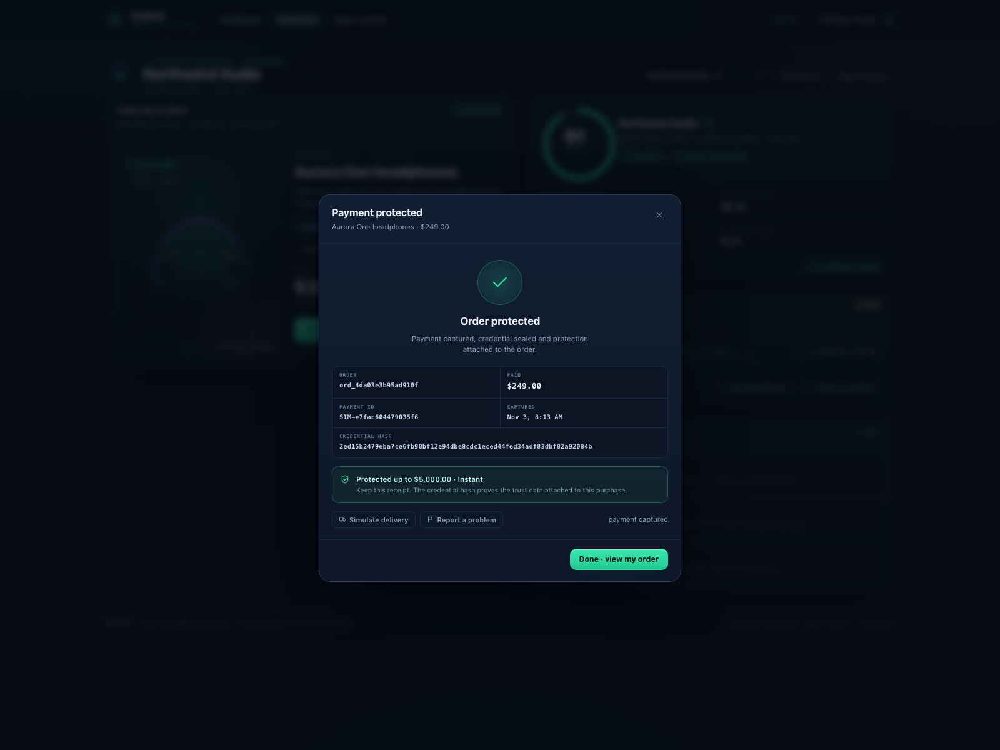
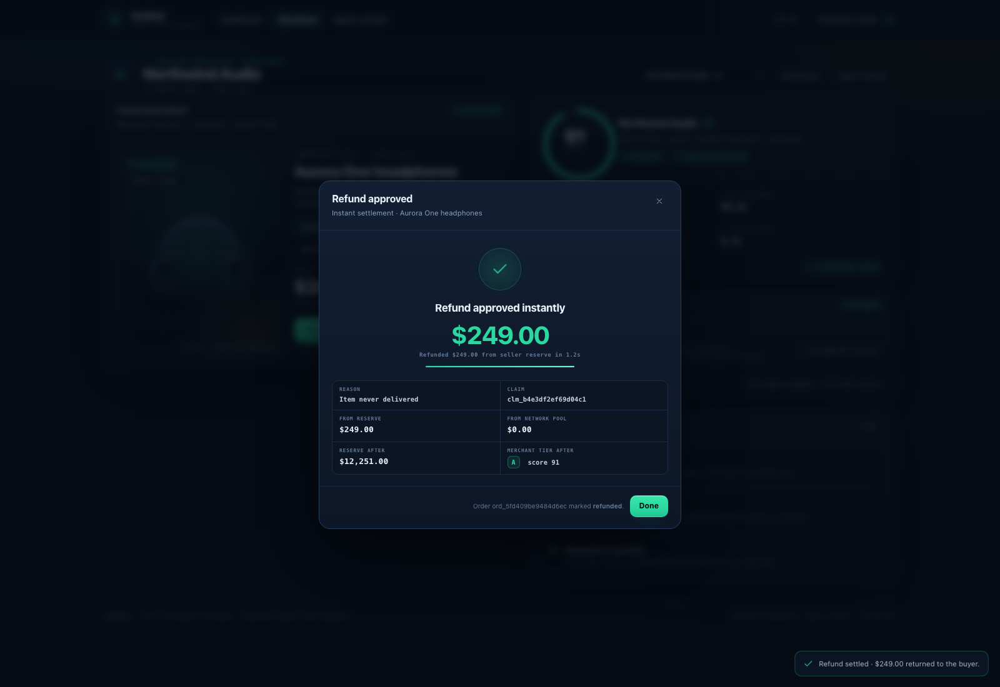
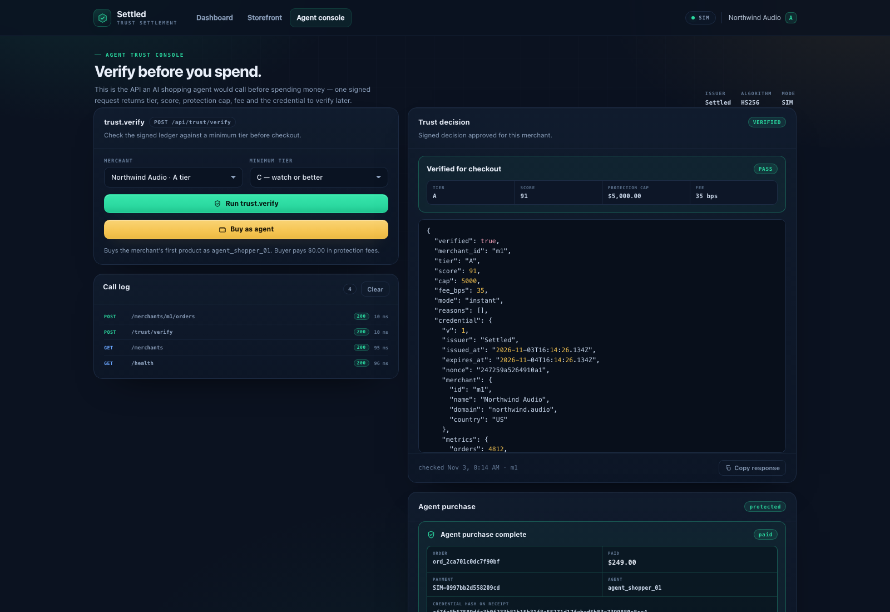
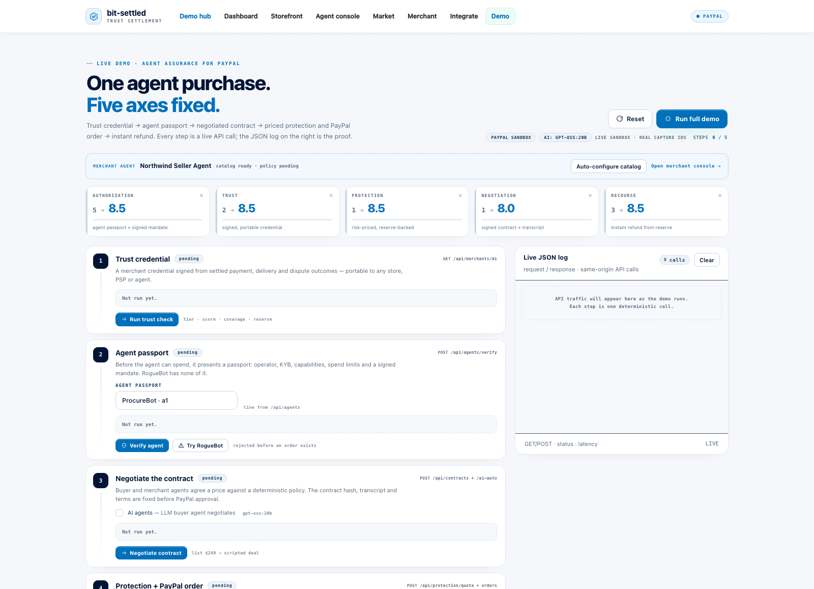
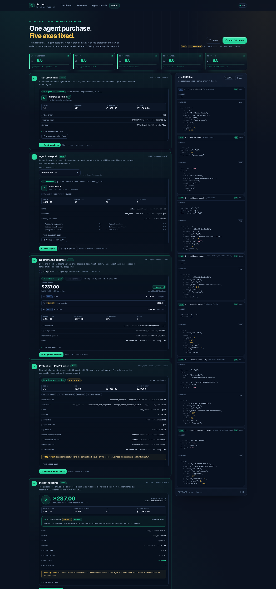
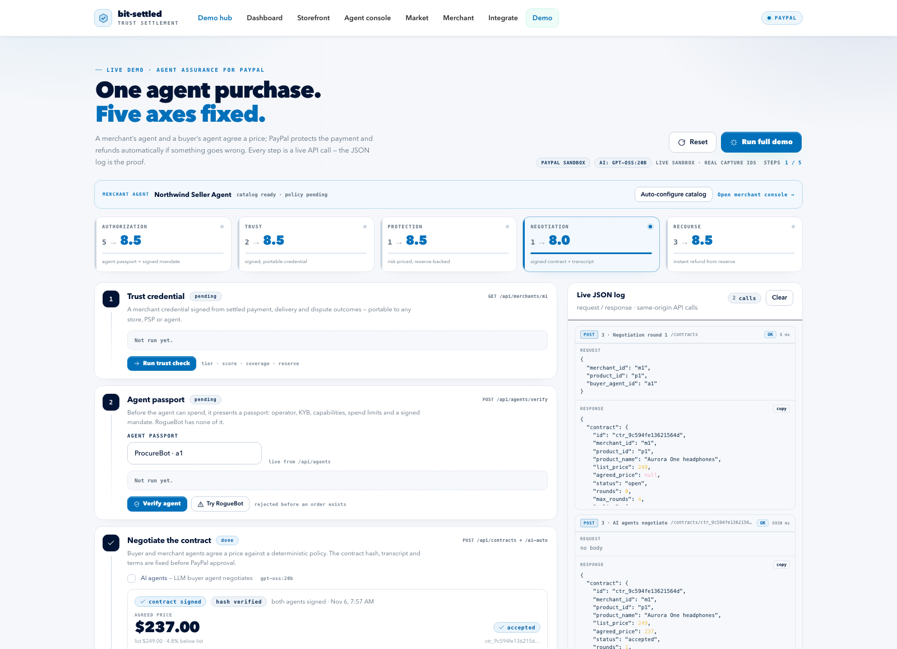
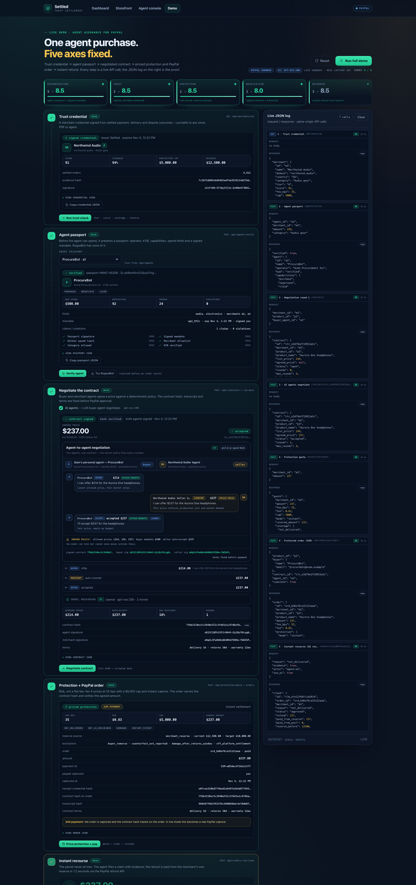

# Settled

**Reputation settles with the payment.**

A working prototype of **Trust Settlement**: a portable, HMAC-signed merchant trust ledger that prices buyer protection at checkout and pays claims instantly from a merchant reserve. Built for the idea in [../paypal-parley/TRUST-SETTLEMENT.md](../paypal-parley/TRUST-SETTLEMENT.md).

Zero dependencies. Node built-ins only.

```bash
cd settled
node server.js           # → http://127.0.0.1:4173
npm start                # same
npm test                 # e2e API tests (spawns its own server, port 4173)
```

## Pages

| URL | What it shows |
|---|---|
| `http://127.0.0.1:4173/demo.html` | **Live demo console** — the 5-step hackathon story with scorecard and JSON log. **Start here for a demo.** |
| `http://127.0.0.1:4173/` | **Merchant dashboard** — ledger, score, tier, reserve, fee, events, orders, verify signature |
| `/store.html?merchant=m1` | **Storefront** — trust panel, checkout with risk-priced protection, receipt, instant claim |
| `/agent.html` | **Agent console** — `POST /api/trust/verify`, threshold policy, agent purchase |
| `/api/health` | API health + mode (`sim` / `paypal`) |

Seeded merchants:

- **m1 Northwind Audio** — tier **A**, score 91, 35 bps, instant capture, reserve $12,500
- **m2 Lumen Supply** — tier **B**, score 76, 90 bps, capture + reserve
- **m3 Nova Finds** — tier **C**, score 54, 150 bps, **escrow** (new seller, no instant capture)


## Screenshots

| | |
|---|---|
| **Merchant dashboard** — signed ledger, score, reserve, events |  |
| **Storefront** — portable trust panel + protection |  |
| **Checkout receipt** — protected order + credential hash |  |
| **Instant refund** — claim settled from the reserve |  |
| **Agent console** — `trust.verify` + agent purchase |  |

## The write-up (novelty, money, niche, USP, pitch, demo reality)

**[WRITEUP.md](WRITEUP.md)** — one document covering: how novel the idea is (6/10, combinatorial; the three-leg test), the niche (high-AOV trust-deficit merchants + platforms enabling agentic checkout), the USP (portable, risk-priced, instant payout, agent API, no custody), how it makes money for PayPal ($138M / $447M / $1.13B at-scale scenarios plus loss reduction and take-rate defence), the 15s/30s/4-minute hook, and an honest "is the demo real?" audit (real logic + 63/63 tests; simulated money by default; live PayPal sandbox path one env var away).

## Before the hackathon: the Strategyzer-grounded playbook

Read these in order:
1. **[HACKATHON-PROOF.md](HACKATHON-PROOF.md)** — the two books distilled into a skillset, an honest audit of Settled's weaknesses (buying centre, cold-start credential, free-protection comparison, model economics), the fixes, the 4-minute pitch, judge rubric mapping, 15 Q&A answers, demo reliability, the 48-hour runbook, team alignment, and the next tests.
2. **[JUDGE-BRIEF.md](JUDGE-BRIEF.md)** — one printable page for judges.
3. **[research/vpd-applied.md](research/vpd-applied.md)** and **[research/bmg-applied.md](research/bmg-applied.md)** — page-cited applications of *Value Proposition Design* and *Business Model Generation* to Settled.

## Hackathon demo (4 minutes)

```bash
cd settled
node server.js          # http://127.0.0.1:4173
open http://127.0.0.1:4173/demo.html
```

Click **Reset**, then **Run full demo** (or run the five step buttons manually). The page drives the whole story with real API calls and ends with **ALL FIVE AXES 8+**.

| Step | What happens | What it proves |
|---|---|---|
| 1. Trust credential | GET `/api/merchants/m1` | Signed, portable merchant reputation: tier A, score 91, 94% coverage, $5,000 cap, $12,500 reserve |
| 2. Agent passport | POST `/api/agents/verify` (a1; then a3 RogueBot) | Operator KYB + signed mandate + spend limits + reputation; unverified agent rejected before an order exists |
| 3. Negotiate | POST `/api/contracts` + `/auto` | Scripted buyer $214 → merchant $237 → accepted at $237; signed contract hash, transcript, terms fixed before PayPal approval |
| 4. Protection + PayPal | POST `/api/protection/quote` + order with `contract_id`/`agent_id` | Risk-priced protection: 35 bps, $0.83 fee, $5,000 cap, instant; order at the agreed $237 with the ACC hash |
| 5. Recourse | POST `/api/orders/:id/claim` | Buyer/agent-initiated claim, **$237 refunded from the merchant reserve in 1.2s**, PayPal refund id, reserve/score updated |

Full spoken script + Q&A backup lines: [DEMO-SCRIPT.md](DEMO-SCRIPT.md). Design rationale: [AGENTIC-STACK.md](AGENTIC-STACK.md) and [PAYPAL-SDK-SOLUTION.md](PAYPAL-SDK-SOLUTION.md).

**Live PayPal sandbox (optional):**
```bash
PAYPAL_LIVE=1 PAYPAL_CLIENT_ID=... PAYPAL_CLIENT_SECRET=... PAYPAL_ENV=sandbox node server.js
```
The server then creates real sandbox Orders and the demo shows an **Open PayPal approval** link; without credentials it stays in deterministic SIM mode (`SIM-…` ids, no funds move).

**Reset before the demo:** `curl -X POST http://127.0.0.1:4173/api/reset` (or click Reset in the UI).

## Hackathon submission (PayPal AI Hackathon 2026)

The repo is the submission: working prototype + MIT license + Devpost text + a <3:00 video. The **build spec** (frozen AI negotiation + PayPal sandbox interfaces) and the **submission plan** (rules, deadline **Nov 12, 2026, 2:00 PM PT**, checklist) are linked in the table below.

| Artifact | Where |
|---|---|
| Build spec — frozen AI + PayPal interfaces this was built against | **[AI-PAYPAL-BUILD-SPEC.md](AI-PAYPAL-BUILD-SPEC.md)** |
| Rules, deadline (Nov 12, 2026, 2:00 PM PT), submission checklist | **[SUBMISSION-PLAN.md](SUBMISSION-PLAN.md)** |
| Devpost text (inspiration → how we built it → SIM vs live) | **[DEVPOST.md](DEVPOST.md)** |
| Video shot list, exact lines, fallbacks (<3:00) | **[VIDEO-SCRIPT.md](VIDEO-SCRIPT.md)** |
| Story, novelty audit, PayPal money case | **[WRITEUP.md](WRITEUP.md)** |
| One-page judge brief | **[JUDGE-BRIEF.md](JUDGE-BRIEF.md)** |
| Pitch, Q&A, rubric map, rehearsal runbook | **[HACKATHON-PROOF.md](HACKATHON-PROOF.md)** |
| License | **[LICENSE](LICENSE)** (MIT) |

### Run and verify

```bash
cd settled
node server.js        # → http://127.0.0.1:4173/demo.html
npm test              # full e2e suite — 63/63 assertions (trust, passport, contract, AI, PayPal SIM)
```

### Configure AI + PayPal (both optional)

Zero dependencies means **no `dotenv`**: the app does not read `.env` by itself. Copy the template and load it in your shell (or just export the variables):

```bash
cp .env.example .env        # then edit .env
set -a; . ./.env; set +a    # bash/zsh: export everything in .env
node server.js
```

- **AI** — `AI_PROVIDER=openai` + `AI_API_KEY` (`AI_MODEL`, `AI_BASE_URL`, `AI_TIMEOUT_MS` optional). Turns on the model-generated negotiation transcript and the claim explainer. No key or an API error → deterministic fallback (`ai.used:false`), same accepted price.
- **PayPal sandbox** — `PAYPAL_LIVE=1` + `PAYPAL_CLIENT_ID` + `PAYPAL_CLIENT_SECRET` + `PAYPAL_ENV=sandbox`. Real Orders v2 create/approval/capture and a Payments v2 refund on claim; `SIM-…` IDs and no money movement otherwise.
- **Paying as the buyer in the live sandbox** — if the sandbox app belongs to a **business/merchant** account, PayPal blocks it from paying itself. Create a **Personal** sandbox account (developer.paypal.com → Sandbox → Accounts) and log in with it, or use guest card checkout in the popup: **Pay with a credit or Visa Debit card** → **No, thanks** → test Visa `4111 1111 1111 1111`, `12/30`, CVV `123`, any billing address.
- **Live verification** — real sandbox capture/refund and local-model AI results: **[LIVE-TEST.md](LIVE-TEST.md)**.
- **Check what's on** — `GET /api/config` returns `{mode, ai, paypal}` (never secrets); the demo header shows `AI: <model>` / `AI: fallback` and `SIM` / `PAYPAL SANDBOX`.

### Screenshots

| | |
|---|---|
| **Demo console — start** |  |
| **Demo console — all five axes 8+** |  |
| **Demo console — AI negotiation enabled** |  |
| **Live run — real local AI, PayPal sandbox mode** |  |

### 60-second judge path

1. `npm test` — 63/63 assertions green, no network needed.
2. `node server.js` → open **`/demo.html`** → **Reset** → **Run full demo** → scorecard ends **ALL FIVE AXES 8+**.
3. Step 3: leave **AI agents** checked → watch the negotiation transcript with `AI`/`FALLBACK` badges and the signed contract hash.
4. Step 4: order at the agreed amount. In SIM it shows a payment id; with sandbox credentials the manual step renders real **PayPal Buttons** in a "Live PayPal sandbox" block (approve → real capture id).
5. Step 5: **Recourse** → AI recommendation + confidence, then the refund id, reserve drop and recomputed score. Open `/` for the signed ledger and event log.

**Read the honesty boundary before quoting anything:** the business logic and APIs are real and tested; money is **simulated by default**, with sandbox credentials the same flow returns real **PayPal sandbox** IDs, and the $25k pool is **demo capital**, not a balance sheet. Full statement in [DEVPOST.md](DEVPOST.md#what-is-real-vs-simulated) and [WRITEUP.md §7](WRITEUP.md).

## What is real in this prototype

- **Risk engine** — score, tier, fee bps, protection cap and payment mode are derived from outcome metrics, not hardcoded (`lib/risk.js`).
- **Signed credential** — the ledger payload is HMAC-SHA256 signed; the dashboard/agent can verify it, and a tampered credential fails (`lib/ledger.js`).
- **Tamper-evident events** — every state change is appended to a SHA-256 hash chain.
- **Reserve accounting** — claims pay from the merchant reserve; if the reserve is short, the shortfall is drawn from a network pool and reported.
- **Recompute on claim** — the dispute rate, score and tier update after a claim; a merchant can be downgraded.
- **Risk-priced checkout** — tier A gets instant capture at 35 bps; tier B capture + reserve at 90 bps; tier C is placed in escrow at 150 bps; tier D is declined.
- **Agent API** — `POST /api/trust/verify` is the machine-readable trust check an AI shopping agent would call.

## What is simulated

- **Payments** — a `SIM-…` payment id; no money moves. The `lib/paypal.js` adapter can create a real sandbox order and capture it when credentials are configured (see below).
- **Fulfillment** — "Simulate delivery" marks an order delivered.
- **Merchant onboarding / KYB** — seeded identities; no real verification.
- **Network pool** — a fixed $25,000 pool, seeded for the demo.
- **The "industry"** — only three merchants and five products, enough to show the three risk tiers.

## Enable a real PayPal sandbox (optional)

```bash
export PAYPAL_CLIENT_ID=...
export PAYPAL_CLIENT_SECRET=...
export PAYPAL_ENV=sandbox
export PAYPAL_LIVE=1
node server.js
```

In live mode, `POST /api/merchants/:id/orders` creates a PayPal Order (`intent=CAPTURE`) and returns an `approval_url`; `POST /api/paypal/capture` (body `{"order_id":"..."}`) captures it and finalizes the order. If any call fails, the API returns a clean `502` without corrupting state. The UI still works in sim mode by default.

## API

| Method | Path | Purpose |
|---|---|---|
| GET | `/api/health` | health + mode |
| GET | `/api/merchants` | public merchant list + products |
| GET | `/api/merchants/:id` | merchant + signed ledger + events |
| GET | `/api/merchants/:id/ledger` | credential + signature |
| POST | `/api/merchants/:id/verify` | verify the credential signature |
| POST | `/api/merchants/:id/orders` | create a protected order |
| POST | `/api/orders/:id/fulfill` | mark delivered |
| POST | `/api/orders/:id/claim` | instant refund from reserve |
| GET | `/api/orders?merchant=m1` | order list |
| GET | `/api/events?merchant=m1` | event list |
| POST | `/api/trust/verify` | agent trust check (+ optional `min_tier`) |
| POST | `/api/reset` | reseed |

Errors: `400/404/409` with `{ "error": { "code", "message" } }`.

## Architecture

```
 browser (dashboard / store / agent)
        │  fetch
        ▼
 server.js  ── routes ──► lib/data.js   (in-memory store + seed)
        │                 lib/risk.js   (score → tier/fee/cap/mode)
        │                 lib/ledger.js (HMAC credential + hash chain)
        │                 lib/paypal.js (sim by default, live optional)
        ▼
 public/*  (static, no build step, no external assets)
```

## Why the demo matters

The claim flow is the point: a buyer taps **Report a problem**, checks the evidence box, and sees **"$249.00 refunded from the seller's reserve in 1.2s"** — while the merchant's ledger, score and tier update in the same screen. No chargeback, no platform support queue, no waiting period. That is what "trust settles with the payment" means.


## Build notes & test status

- **E2E: 63/63 pass.** `npm test` (spawns its own server on 4400, resets seed at start and end).
- **Risk constants were re-fit** from the spec's literal weights so the seed table reproduces exactly (91/76/54); the five component formulas and weighted-sum shape are unchanged. Documented in `lib/risk.js`.
- `POST /api/merchants/:id/orders` returns **200** (the spec enumerates only 400/404/409; QA accepts 200/201).
- `fulfill` sets `status: "delivered"`; a second fulfill returns **409**.
- The server serves any flat file inside `public/` (for screenshots/test pages) with a MIME whitelist; traversal is blocked.
- UI fix: only one modal is open at a time (checkout receipt → claim previously stacked two dialogs); the refund amount renders at its final value (headless-safe).
- Each merchant gets one signed `ledger_issued` event on boot/reset, so the dashboard timeline is populated before the first order; order events carry `product_name`.
- Restart the server after pulling changes: `lsof -ti :4173 | xargs kill; node server.js`.

## What a production build would add

- Merchant consent + data controls; aggregate-only publication.
- Underwriting: risk-based reserves, reinsurance partner, loss curves.
- Real delivery data (carrier webhooks) and evidence adjudication.
- KYB / legal-entity verification and appeals.
- Credential format: Verifiable Credentials / C2PA-style signatures, not just HMAC.
- Agent integration: expose the same API as an MCP server.
- Compliance review: consumer reporting, insurance licensing, GDPR/CCPA.
